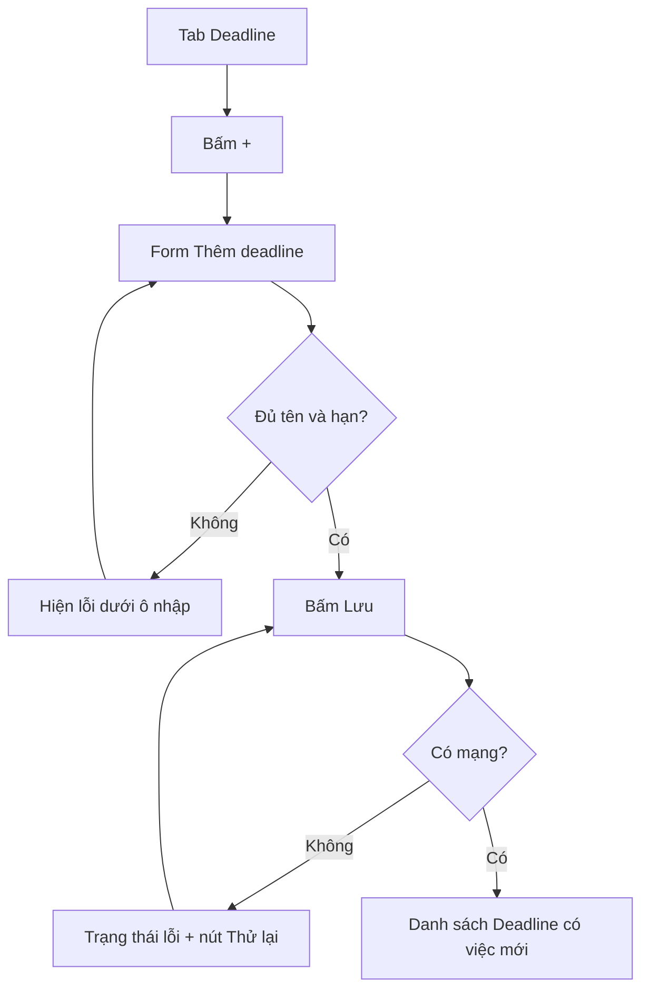
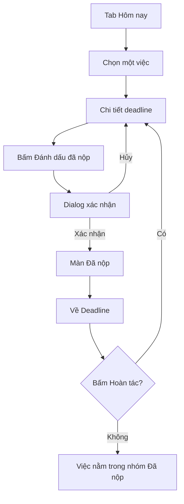
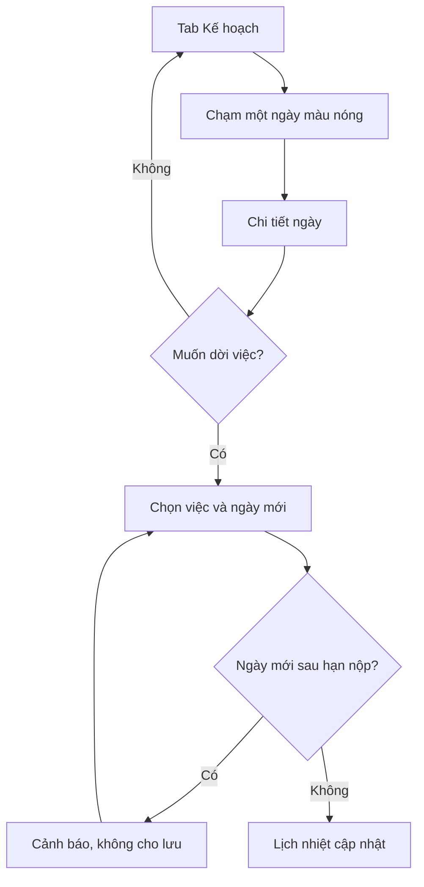

# Information architecture và user flow

> BẢN NHÁP do AI gợi ý. Bạn phải xem lại, sửa cho đúng ý mình, rồi xóa dòng này.

## Information architecture

Cấp cao nhất (bottom navigation):
1. Hôm nay
2. Kế hoạch (lịch nhiệt khối lượng)
3. Deadline
4. Lịch bận

Màn lồng bên trong:
5. Thêm deadline (mở từ nút "+" ở Deadline)
6. Chi tiết deadline (mở từ một dòng ở Deadline hoặc Hôm nay)
7. Đã nộp (mở sau khi đánh dấu xong ở Chi tiết deadline)
8. Chi tiết ngày (mở từ một ô ở Kế hoạch)

Biến thể trạng thái (không tính là màn riêng): rỗng, đang tải, lỗi mất mạng.

## Flow 1 — Thêm deadline mới
- Điểm bắt đầu: tab Deadline. Mục tiêu: lưu một deadline. Điểm kết thúc: deadline hiện trong danh sách.

## Flow 2 — Nộp một deadline
- Điểm bắt đầu: tab Hôm nay. Mục tiêu: đánh dấu đã nộp. Điểm kết thúc: màn Đã nộp.

## Flow 3 — Xem ngày quá tải và dời việc
- Điểm bắt đầu: tab Kế hoạch. Mục tiêu: giảm tải cho một ngày nặng. Điểm kết thúc: lịch nhiệt đổi màu.

## Bảng ánh xạ flow sang màn hình
| Flow | Màn hình sử dụng |
|---|---|
| 1. Thêm deadline | Deadline, Thêm deadline |
| 2. Nộp deadline | Hôm nay, Chi tiết deadline, Đã nộp, Deadline |
| 3. Dời việc | Kế hoạch, Chi tiết ngày |

TODO: màn "Lịch bận" chưa thuộc flow nào. Đề yêu cầu mọi màn hình được ít nhất một flow sử dụng, nên bạn cần thêm nó vào một flow hoặc thêm flow thứ tư.
