# Information architecture và user flow

Nguồn: file Figma [`PRM393-LAB2-Study-Planner`](https://www.figma.com/design/OkTRYkrsoJ0nkluNO4mrHz/PRM393-LAB2-Study-Planner?node-id=0-1): page **01 User Flow** (sơ đồ 15 flow) và page **06 Prototype** (15 flow starting point cùng tên). Cập nhật ngày 20/10/2026.

**Quy ước mã màn hình:** mã màn trong tài liệu này là mã trong tên frame Figma, ví dụ `7s` là frame `Device · 7s · Giai đoạn: Chạy thực nghiệm`. Không dùng mã khác. Các file `persona.md`, `screen-spec.md` và `flutter-handoff.md` dùng cùng bộ mã này.

**Quy ước mã flow:** `C` là flow chính, `P` là flow phụ, `S` là flow trạng thái và lỗi. Tên và số thứ tự giống hệt page 01 và page 06.

---

## 1. Information architecture

### 1.1 Cấu trúc điều hướng

App có **4 tab** trên thanh điều hướng dưới (component `BottomNav/iPhone · 4 tab`):

| Tab | Màn gốc | Có gì bên trong |
|---|---|---|
| Hôm nay | `2` | Hạn hôm nay, thẻ chuỗi đúng hạn, dải 7 ngày theo độ nặng, mục "Cần để ý". Chuông thông báo ở góc trên mở `13` |
| Kế hoạch | `3` | Nút chuyển **Tháng / Tuần**. Tháng là lịch nhiệt (`3`), Tuần là lưới giờ (`9`) |
| Deadline | `5` | Nút chuyển **Sắp đến hạn / Môn học**. Sắp đến hạn nhóm theo Quá hạn, Hôm nay, Tuần này. Môn học là `10b` |
| Hồ sơ | `10` | Thông tin tài khoản, chuỗi, thành tích nhỏ, lối vào Cài đặt |

Nút **+** (thêm deadline) có ở Hôm nay, Kế hoạch và Deadline, cùng mở `6`.

Sau khi đăng nhập, app mở vào `2 · Hôm nay`. Người chưa đăng nhập chỉ thấy `1 · Đăng nhập`.

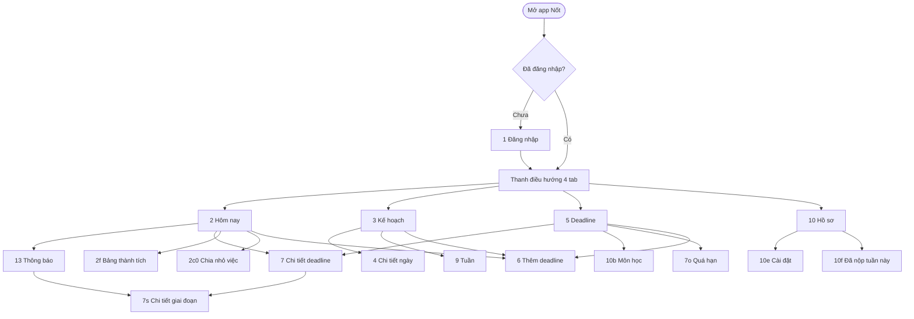

**Quy tắc nút Back:**

- Màn lồng (không phải 4 màn gốc) có App bar với nút Back và ẩn thanh điều hướng.
- Back ở các bước `6` đến `6b5` quay về bước trước. Back ở `6` đóng luồng thêm deadline và về tab đã mở nó.
- `8 · Đã nộp` không quay lại `7d`; nút "Về Deadline" mở `5`.
- Back ở tab khác Hôm nay về `2`. Back ở `2` hoặc `1` thoát app.
- Dialog (overlay) đóng bằng nút Huỷ hoặc chạm ra ngoài.

### 1.2 Danh sách màn hình

Page 03 Final UI có **74 frame** trong 7 nhóm. Frame có cùng số gốc là biến thể trạng thái của cùng một màn (ví dụ `6b3` có 4 trạng thái). Overlay là dialog, không tính là màn riêng.

| Nhóm | Mã | Màn hình | Cấp | Vào từ |
|---|---|---|---|---|
| **01 Xác thực** | `1` | Đăng nhập (Google, email, đăng ký) | Cổng vào | Mở app khi chưa đăng nhập, Đăng xuất |
| | `1b` | Đăng nhập bằng email | Lồng | `1` |
| | `1d` | Đăng nhập bằng email — lỗi "Sai email hoặc mật khẩu" | Biến thể của `1b` | `1b` khi sai |
| | `1c` | Đăng ký (tên hiển thị, email, mật khẩu ≥ 8 ký tự) | Lồng | `1`, `1b` |
| | `1e` | Quên mật khẩu (nhập email, Gửi link) | Lồng | `1b`, `1d` |
| | `1f` | Kiểm tra email (Mở ứng dụng email, Gửi lại) | Lồng | `1e` |
| | `1g` | Đặt mật khẩu mới | Lồng | Mở link trong email |
| | `1h` | Đổi mật khẩu thành công (Vào Nốt) | Lồng | `1g` |
| **02 Làm quen** | `O1` | Làm quen với Nốt (Bắt đầu, Để sau) | Lồng | Sau `1c` hoặc lần đầu đăng nhập Google |
| | `O2` | Câu 1/3: Bạn đang là? | Lồng | `O1` |
| | `O3` | Câu 2/3: Tuần của bạn có gì cố định? (chọn nhiều) | Lồng | `O2` |
| | `O4` | Câu 3/3: Bạn muốn tốt hơn ở điều gì? (chọn nhiều) | Lồng | `O3` |
| **03 Hôm nay** | `2` | Hôm nay | Tab 1 | Sau đăng nhập, thanh điều hướng |
| | `2c0` | Chia nhỏ — bước 1/3: Vì sao việc này hay bị dời? | Lồng | Thẻ ở `2`, `9e`, `4d` |
| | `2c` | Chia nhỏ — bước 2/3: Chia thành bước nhỏ | Lồng | `2c0` |
| | `2c2` | Chia nhỏ — thêm bước | Biến thể của `2c` | `2c` |
| | `2c3` | Chia nhỏ — bước 3/3: Xếp giờ cho từng bước | Lồng | `2c`, `2c2` |
| | `3c` | Kế hoạch — đã xếp 3 buổi | Biến thể của `3` | `2c3` |
| | `2f` | Bảng thành tích tuần này | Lồng | Thẻ chuỗi ở `2`, `10`, thông báo Hoàn thành |
| **04 Kế hoạch** | `3` | Kế hoạch — Tháng (lịch nhiệt) | Tab 2 | Thanh điều hướng |
| | `4` | Chi tiết ngày (có gợi ý giãn việc) | Lồng | Chạm một ngày ở `3` |
| | `4b` | Xem trước dời việc (Giãn việc) | Lồng | `4`, thông báo Gợi ý dời, thẻ ngày quá nặng ở `2` |
| | `4c` | Chọn ngày dời (bottom sheet) | Sheet trên `4b` | `4b` |
| | `3d` | Kế hoạch — đã dời (snackbar Hoàn tác) | Biến thể của `3` | `4b`, `4c` |
| | `4d` | Chi tiết ngày — không dời được | Biến thể của `4` | Chạm ngày đỏ khi không còn ngày nhẹ |
| | `9` | Kế hoạch — Tuần (lưới giờ) | Nút Tuần trong tab 2 | `3` |
| | `9d` | Thêm giờ bận (bottom sheet) | Sheet trên `9` | Nút + ở `9` |
| | `9e` | Nhấn giữ để hoãn (menu) | Biến thể của `9` | Nhấn giữ một việc ở `9` |
| **05 Thông báo** | `13` | Thông báo (Tất cả, Chưa đọc, Đọc hết) | Lồng | Chuông ở `2` |
| | `13A`, `13B` | Hai phương án hiển thị của `13`: nền nhạt cho tin chưa đọc, kiểu hộp thư | Phương án | — |
| | `13p` | Thông báo đẩy trên màn khoá (Mở giai đoạn, Nhắc lại 15 phút) | Hệ thống | Đến giờ nhắc |
| **06 Deadline** | `5` | Deadline — Sắp đến hạn | Tab 3 | Thanh điều hướng |
| | Rỗng | Trạng thái rỗng: "Chưa có deadline nào" + Thêm deadline | Trạng thái của `5` | — |
| | Đang tải | Trạng thái đang tải: "Đang đồng bộ deadline…" | Trạng thái của `5` | — |
| | Lỗi mất mạng | Trạng thái lỗi: "Mất kết nối" + Thử lại | Trạng thái của `5` | — |
| | `10b` | Deadline — Môn · Dự án | Nút Môn học trong tab 3 | `5`, `10e` |
| | `10c` | Chi tiết môn học | Lồng | `10b` |
| | `6b` | Thêm môn học (tên, mã môn, màu) | Lồng | `6`, `10b` |
| | `6` | Thêm deadline — B1/5 Môn hoặc dự án | Lồng | Nút + ở `2`, `3`, `5`; trạng thái Rỗng |
| | `6b2` | Thêm deadline — B2/5 Tên, loại, hạn chót, nhắc trước | Lồng | `6` |
| | `6b2a` | Thêm deadline — B3/5 Mô tả (AI dùng để gợi ý giai đoạn) | Lồng | `6b2` |
| | `6b3` | Thêm deadline — B4/5 Giai đoạn. 4 trạng thái: Chưa có giai đoạn, AI đang chia, Đề xuất của AI, AI lỗi | Lồng | `6b2a` |
| | `6b4` | Thêm deadline — B4/5 Thêm giai đoạn tự nhập (tên, từ ngày, đến ngày, giờ nhắc mỗi ngày) | Sheet trên `6b3` | `6b3` |
| | `6b5` | Thêm deadline — B5/5 Xem lại và lịch thông báo | Lồng | `6b3` |
| | `7c` | Chi tiết deadline vừa tạo (snackbar "Đã thêm …") | Biến thể của `7` | `6b5` |
| | `7` | Chi tiết deadline (giai đoạn, link nộp, ghi chú, Hoàn thành deadline) | Lồng | `2`, `5`, `10c`, thông báo Hạn hôm nay |
| | `7d` | Chi tiết deadline — đủ 3/3 giai đoạn | Biến thể của `7` | Tick đủ giai đoạn |
| | `7s` | Chi tiết giai đoạn (ngày x/y, nhắc mỗi ngày, tài liệu, ghi chép) | Lồng | `7`, `13p`, thông báo Sắp đến giờ |
| | `7s1`, `7s2` | Chi tiết giai đoạn đã xong | Biến thể của `7s` | `7`, `2f` |
| | `7t` | Thêm ghi chép và tài liệu (tệp, ảnh, link) | Sheet trên `7s` | `7s` |
| | `8` | Đã nộp (chuỗi đúng hạn, Xem việc tiếp theo, Về Deadline) | Lồng, toàn màn | Dialog Hoàn thành deadline |
| | `7b` | Sửa deadline | Lồng | Nút bút chì ở `7` |
| | `5e` | Deadline — đã xoá (snackbar) | Biến thể của `5` | Dialog Xoá deadline |
| | `7o` | Quá hạn (vì sao quá hạn, 3 cách xử lý) | Lồng | Việc quá hạn ở `5`, thông báo Quá hạn |
| | `7o2` | Dời hạn (chọn hạn mới) | Biến thể của `7o` | `7o` |
| | `5o1`, `5o2`, `5o3` | Deadline sau khi: nộp muộn, dời hạn, bỏ deadline | Biến thể của `5` | `7o`, `7o2`, dialog Bỏ |
| **07 Hồ sơ, Cài đặt** | `10` | Hồ sơ | Tab 4 | Thanh điều hướng |
| | `10f` | Đã nộp tuần này | Lồng | Thẻ thống kê ở `10` |
| | `10e` | Cài đặt (nhắc trước hạn, Môn học của tôi, Hướng dẫn, Công cụ demo, Đăng xuất) | Lồng | `10` |
| | `11` | Hướng dẫn sử dụng | Lồng | `10e` |
| | `12` | Ý nghĩa icon | Lồng | `11` |
| | `14` | Cấu hình ứng dụng (giá trị Remote Config, Tải lại) | Lồng | Công cụ demo ở `10e` |
| | `15` | Kiểm tra lỗi (Ghi lỗi không đóng app, Gây lỗi thử) | Lồng | `14` |
| | `15b` | Kiểm tra lỗi — dialog "Đóng app để thử lỗi?" | Dialog trên `15` | `15` |

`14` và `15` là công cụ demo cho Lab 3 (Remote Config và Crashlytics).

### 1.3 Dialog, bottom sheet và snackbar

| Mã | Loại | Ở màn | Nội dung |
|---|---|---|---|
| Overlay · Hoàn thành deadline | Dialog xác nhận | `7d` | "Hoàn thành Lab 2?" · Huỷ, Hoàn thành |
| Overlay · Xoá deadline | Dialog destructive | `7b` | "Xoá Lab 2: Thiết kế UI?" Xoá cả giai đoạn, ghi chép, lời nhắc, không hoàn tác được · Huỷ, Xoá |
| Overlay · Bỏ deadline | Dialog destructive | `7o` | "Bỏ Quiz ITE302c tuần 1?" Ẩn khỏi danh sách, không còn nhắc · Huỷ, Bỏ deadline |
| `15b` | Dialog destructive | `15` | "Đóng app để thử lỗi?" · Để sau, Đóng app |
| `4c` | Bottom sheet | `4b` | Chọn ngày dời; màu ngày là độ nặng nếu thêm việc vào |
| `6b4` | Bottom sheet | `6b3` | Thêm một giai đoạn tự nhập |
| `7t` | Bottom sheet | `7s` | Thêm ghi chép, tệp, ảnh, link |
| `9d` | Bottom sheet | `9` | Thêm giờ bận: tên, từ giờ, đến giờ, lặp mỗi tuần |
| `9e` | Menu nhấn giữ | `9` | Để mai, Chia nhỏ việc này |
| Snackbar | Snackbar | `7c`, `3d`, `5e`, `5o1`, `5o2`, `5o3` | "Đã thêm …", "Đã dời · Hoàn tác", "Đã xoá deadline", "Đã nộp muộn", "Đã dời hạn", "Đã bỏ deadline" |

---

## 2. User flow

15 flow, giống page 01 và page 06: **4 flow chính** (C1–C4), **8 flow phụ** (P1–P8), **3 flow trạng thái** (S1–S3). Mỗi flow có một flow starting point trong page 06.

Ký hiệu trong sơ đồ: hình chữ nhật là màn hình, hình thoi là quyết định, hình tròn là bắt đầu hoặc kết thúc.

### C1 · Thêm deadline

- **Persona:** Minh (chính), Bảo Ngọc, Quốc Huy.
- **Bắt đầu:** nút + ở Hôm nay, Kế hoạch hoặc Deadline. Điểm bắt đầu trong prototype: `6`.
- **Mục tiêu:** thêm một deadline dài (ví dụ "Nộp paper hội nghị", hạn CN 15/11), chia 31 ngày thành giai đoạn, mỗi giai đoạn có giờ nhắc.
- **Kết thúc:** `7c`, deadline vừa tạo với 4 giai đoạn và 4 mốc nhắc.
- **Nhánh thay thế:**
  - Môn hoặc dự án chưa có → Thêm môn mới (`6b`), rồi quay lại `6`.
  - Chia giai đoạn bằng AI (theo mô tả ở B3) hoặc tự nhập từng giai đoạn ở `6b4`.
  - Ở Đề xuất của AI, người dùng sửa, xoá hoặc bấm Tạo lại.
- **Nhánh lỗi và phục hồi:** gọi AI bị lỗi hoặc mất mạng → `6b3 · AI lỗi` ("Mất kết nối khi gọi AI. Mô tả của bạn vẫn được giữ.") → Thử lại, hoặc Tự nhập tay.
- **Phần 2 (sau khi lưu):** đến giờ nhắc → thông báo `13p` → mở `7s` → thêm ghi chép, tệp (DOCX, PDF, XLSX, ZIP…), ảnh hoặc link ở `7t` → lưu, tài liệu hiện ở `7s`. Tick xong giai đoạn thì sang giai đoạn tiếp theo.

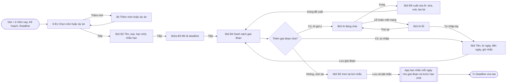

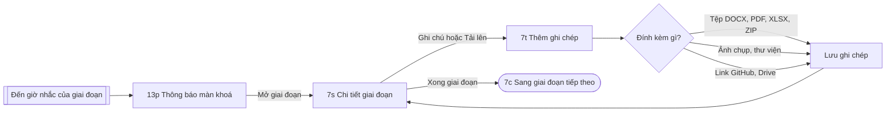

Lối vào khác của phần 2: từ `7c` chạm một giai đoạn để mở `7s`; từ `2` bấm chuông → `13` → thông báo "Sắp đến giờ" → `7s`.

### C2 · Hôm nay → nộp bài

- **Persona:** Minh.
- **Bắt đầu:** `2 · Hôm nay`, thẻ "Hạn hôm nay: Lab 2: Thiết kế UI".
- **Mục tiêu:** làm nốt giai đoạn cuối, ghi chép, tải tài liệu, rồi hoàn thành deadline.
- **Kết thúc:** `8 · Đã nộp` ("Sớm hơn hạn 6 giờ", "Chuỗi 3 ngày đúng hạn") → Về Deadline (`5`).
- **Nhánh thay thế:**
  - Huỷ ở dialog Hoàn thành → đóng dialog, ở lại `7d`.
  - Sửa deadline: bút chì ở `7` → `7b`.
  - Xoá deadline: ở `7b` → dialog Xoá → `5e` (snackbar "Đã xoá deadline").
- **Ngăn lỗi:** nút "Hoàn thành deadline" chỉ bật khi đã tick đủ giai đoạn ("Tick đủ 3 giai đoạn để hoàn thành").

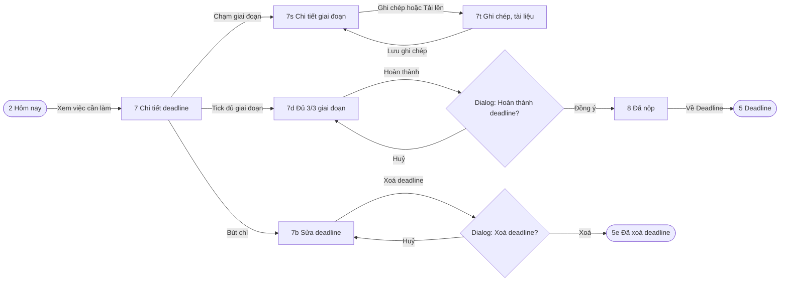

### C3 · Thông báo → mở giai đoạn

- **Persona:** Minh, Đăng Khoa, Quốc Huy.
- **Bắt đầu:** đến giờ nhắc (ví dụ 18:00 hoặc 20:00 mỗi ngày). Điểm bắt đầu trong prototype: `13p`.
- **Mục tiêu:** chạm thông báo là mở đúng việc cần làm.
- **Kết thúc:** màn của việc đó (`7s`, `7`, `4b`, `2f` hoặc `7o`).
- **Nhánh thay thế:**
  - Đang bận (ví dụ Quốc Huy đang họp) → "Nhắc lại 15 phút" trên `13p`.
  - Mở từ trong app: chuông có badge ở `2` → `13` → chạm thông báo, app mở màn theo loại thông báo.
- **Nhánh lỗi:** thông báo loại Quá hạn → `7o` (đi tiếp ở P3).

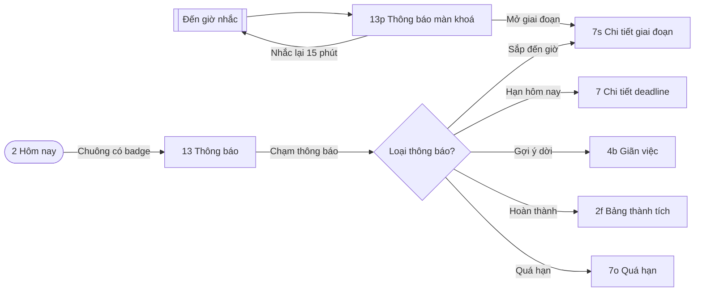

### C4 · Dời việc khi ngày quá nặng

- **Persona:** Đăng Khoa.
- **Bắt đầu:** `3 · Kế hoạch`, chạm một ngày màu đỏ. Điểm bắt đầu trong prototype: `4`.
- **Mục tiêu:** app tính độ nặng của ngày và gợi ý ngày nhẹ hơn **trước hạn nộp**; người dùng dời việc trong vài chạm.
- **Kết thúc:** `3d · Kế hoạch — đã dời` (ngày bớt nặng, snackbar có Hoàn tác).
- **Nhánh thay thế:**
  - Không thích ngày đề xuất → Đổi ngày ở `4c` → `3d`.
  - Đổi ý → Hoàn tác trên snackbar → về `3`.
  - Lối vào khác: thẻ "Thứ Sáu đang quá nặng" ở `2`, hoặc thông báo Gợi ý dời → thẳng `4b`.
- **Nhánh lỗi và phục hồi:** không còn ngày nhẹ trước hạn → `4d` ("Chưa có ngày đủ nhẹ để dời") → Chia nhỏ một việc → `2c0`, đi tiếp ở P7.
- **Ngăn lỗi:** app chỉ đề xuất ngày trước hạn nộp; việc đến hạn ngay hôm đó không có trong danh sách dời.

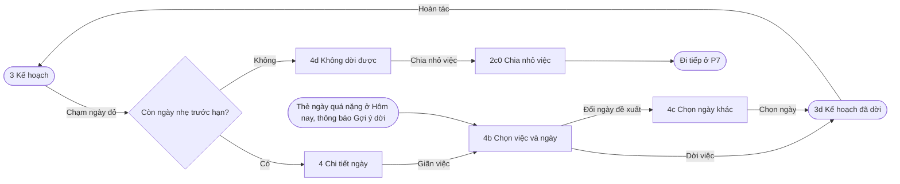

### P1 · Đăng ký và làm quen lần đầu

- **Persona:** Bảo Ngọc.
- **Bắt đầu:** `1 · Đăng nhập`.
- **Mục tiêu:** tạo tài khoản và trả lời 3 câu hỏi để app cá nhân hoá.
- **Kết thúc:** `2 · Hôm nay`.
- **Nhánh thay thế:** Tiếp tục với Google → vào thẳng `O1`; "Để sau" ở `O1` → `2`; "Bỏ qua bước này" ở `O3`, `O4`.

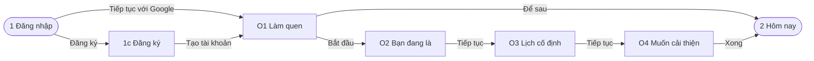

### P2 · Đăng nhập và quên mật khẩu

- **Persona:** chung.
- **Bắt đầu:** `1b · Đăng nhập bằng email`.
- **Mục tiêu:** đăng nhập bằng email; nếu quên mật khẩu thì đặt lại qua **link gửi vào email**.
- **Kết thúc:** `2 · Hôm nay`.
- **Nhánh lỗi và phục hồi:** sai mật khẩu → `1d` ("Sai email hoặc mật khẩu.") → Quên mật khẩu? → `1e` → `1f` → `1g` → `1h` → Vào Nốt.

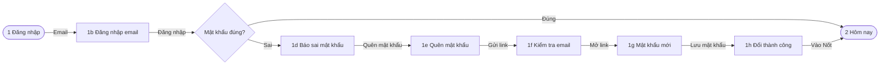

### P3 · Trễ deadline

- **Persona:** Minh.
- **Bắt đầu:** `7o · Quá hạn` (chạm việc ở mục Quá hạn của `5`).
- **Mục tiêu:** chọn một trong ba cách: đã nộp muộn, dời hạn, hoặc bỏ deadline.
- **Kết thúc:** `5o1`, `5o2` hoặc `5o3`.
- **Nhánh lỗi và phục hồi:** Huỷ ở dialog Bỏ deadline → về `7o`.

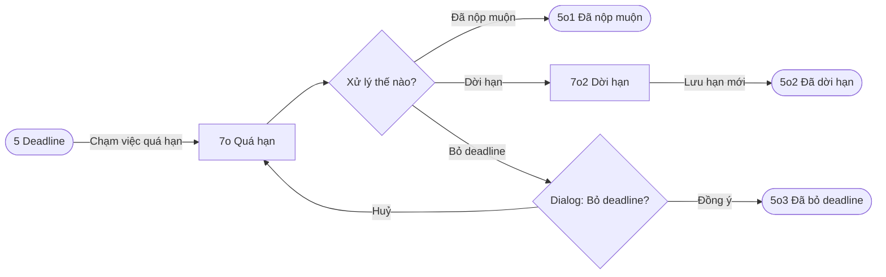

### P4 · Ngày không dời được

- **Persona:** chung (nhánh lỗi của C4).
- **Bắt đầu:** `4d · Chi tiết ngày — không dời được`.
- **Mục tiêu:** khi mọi việc đều sát hạn, app gợi ý chia nhỏ việc thay vì dời.
- **Kết thúc:** `2c0`, đi tiếp ở P7.

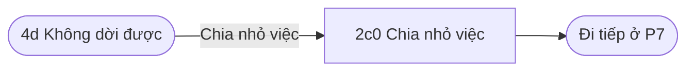

### P5 · Bảng thành tích tuần này

- **Persona:** chung.
- **Bắt đầu:** `2f` (từ thẻ "3 ngày liên tiếp đúng hạn" ở `2`, hoặc "Xem cả bảng" ở `10`).
- **Mục tiêu:** xem việc đã làm đúng hạn và chuỗi ngày đúng hạn trong tuần.
- **Kết thúc:** `7s1`, giai đoạn đã xong.

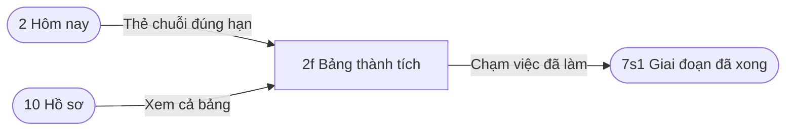

### P6 · Hồ sơ và cài đặt

- **Persona:** chung.
- **Bắt đầu:** `10 · Hồ sơ`.
- **Mục tiêu:** xem thống kê, đổi cài đặt nhắc hạn, quản lý môn học, đọc hướng dẫn, đăng xuất.
- **Kết thúc:** tuỳ nhánh; Đăng xuất → `1`.

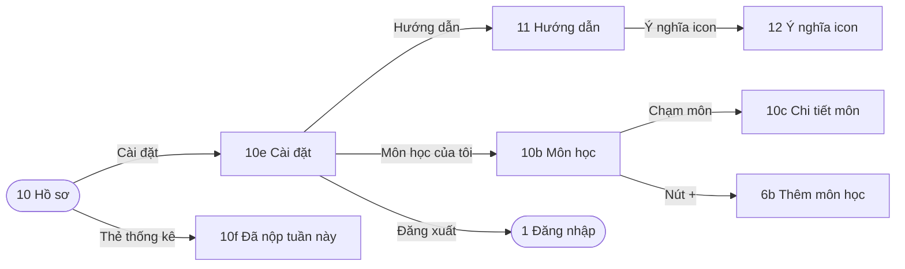

### P7 · Chia nhỏ việc hay bị dời

- **Persona:** Bảo Ngọc.
- **Bắt đầu:** `2c0`. Lối vào: thẻ ở `2`, nhấn giữ một việc ở lịch tuần (`9e`), hoặc `4d`.
- **Mục tiêu:** tách một việc đã bị dời nhiều lần ("Đã dời 3 lần") thành bước nhỏ, mỗi bước có giờ làm.
- **Kết thúc:** `3c · Kế hoạch — đã xếp 3 buổi`.
- **Cách làm:** bước 1 chọn lý do bị dời (Việc quá to, Không có giờ trống, Chưa rõ đề bài); bước 2 Nốt gợi ý 3 bước, mỗi bước khoảng 45 phút, người dùng sửa hoặc thêm; bước 3 **người dùng chọn giờ** cho từng bước.
- **Nhánh thay thế:** Thêm bước → `2c2` → `2c3`.

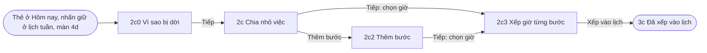

### P8 · Lịch tuần và giờ bận

- **Persona:** Đăng Khoa, Quốc Huy.
- **Bắt đầu:** `9 · Tuần` (nút Tuần trong tab Kế hoạch).
- **Mục tiêu:** xem việc theo giờ, thêm giờ bận (ca làm, giờ đi làm), hoãn một việc.
- **Kết thúc:** về `9` với giờ bận mới, hoặc việc đã hoãn.
- **Nhánh thay thế:** nhấn giữ một việc → `9e` → Để mai, hoặc Chia nhỏ việc này → `2c0` (P7).

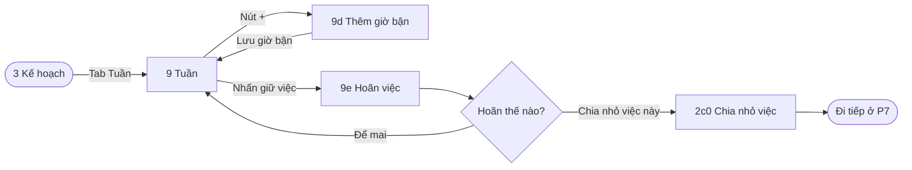

### S1 · Trạng thái rỗng

- **Persona:** Bảo Ngọc (người dùng mới).
- **Bắt đầu:** `5` khi chưa có deadline ("Chưa có deadline nào. Nốt sẽ nhắc bạn trước hạn.").
- **Kết thúc:** `6`, đi tiếp ở C1.

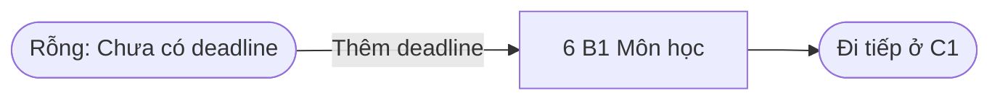

### S2 · Lỗi mất mạng

- **Persona:** chung (Đăng Khoa hay gặp 4G chập chờn).
- **Bắt đầu:** `5` khi không tải được dữ liệu ("Mất kết nối. Kiểm tra kết nối rồi thử lại.").
- **Kết thúc:** `5` có dữ liệu.

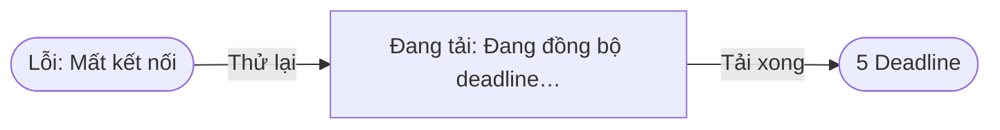

### S3 · Kiểm tra lỗi (công cụ demo)

- **Persona:** dùng khi demo (chuẩn bị cho Crashlytics ở Lab 3).
- **Bắt đầu:** `15 · Kiểm tra lỗi` (từ `10e` → Công cụ demo → `14`).
- **Mục tiêu:** ghi một lỗi không đóng app, hoặc gây lỗi thử để gửi báo cáo.
- **Nhánh phục hồi:** dialog `15b` "Đóng app để thử lỗi?" → Để sau → ở lại `15`.

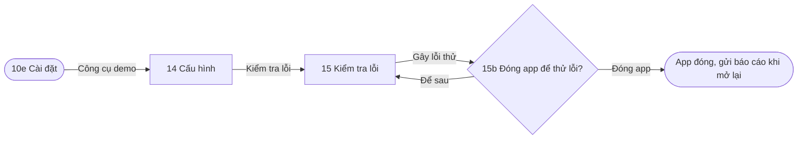

---

## 3. Bảng ánh xạ flow sang màn hình

| Flow | Tên | Persona | Màn hình dùng | Dialog, sheet, trạng thái |
|---|---|---|---|---|
| C1 | Thêm deadline | Minh, Bảo Ngọc, Quốc Huy | `6`, `6b`, `6b2`, `6b2a`, `6b3`, `6b4`, `6b5`, `7c`, `13p`, `7s`, `7t` | `6b3` Chưa có / AI đang chia / Đề xuất / AI lỗi; sheet `6b4`, `7t` |
| C2 | Hôm nay → nộp bài | Minh | `2`, `7`, `7s`, `7t`, `7d`, `8`, `5`, `7b`, `5e` | Overlay Hoàn thành, Overlay Xoá |
| C3 | Thông báo → mở giai đoạn | Minh, Đăng Khoa, Quốc Huy | `13p`, `2`, `13`, `7s`, `7`, `4b`, `2f`, `7o` | Thông báo đẩy |
| C4 | Dời việc khi ngày quá nặng | Đăng Khoa | `3`, `4`, `4b`, `4c`, `3d`, `4d`, `2c0` | Sheet `4c`, snackbar Hoàn tác |
| P1 | Đăng ký và làm quen | Bảo Ngọc | `1`, `1c`, `O1`, `O2`, `O3`, `O4`, `2` | — |
| P2 | Đăng nhập và quên mật khẩu | Chung | `1`, `1b`, `1d`, `1e`, `1f`, `1g`, `1h`, `2` | Lỗi `1d` |
| P3 | Trễ deadline | Minh | `5`, `7o`, `7o2`, `5o1`, `5o2`, `5o3` | Overlay Bỏ deadline |
| P4 | Ngày không dời được | Chung | `4d`, `2c0` | — |
| P5 | Bảng thành tích tuần này | Chung | `2`, `10`, `2f`, `7s1` | — |
| P6 | Hồ sơ và cài đặt | Chung | `10`, `10e`, `10f`, `11`, `12`, `10b`, `10c`, `6b`, `1` | — |
| P7 | Chia nhỏ việc hay bị dời | Bảo Ngọc | `2`, `9e`, `4d`, `2c0`, `2c`, `2c2`, `2c3`, `3c` | — |
| P8 | Lịch tuần và giờ bận | Đăng Khoa, Quốc Huy | `3`, `9`, `9d`, `9e`, `2c0` | Sheet `9d`, menu `9e` |
| S1 | Trạng thái rỗng | Bảo Ngọc | `5` (Rỗng), `6` | — |
| S2 | Lỗi mất mạng | Chung | `5` (Lỗi mất mạng, Đang tải) | Skeleton |
| S3 | Kiểm tra lỗi | Demo | `10e`, `14`, `15`, `15b` | Dialog `15b` |

Persona chính của mỗi flow lấy theo ma trận ở page 00 Persona. "Chung" là flow không gắn với một persona riêng.

**Kiểm tra mọi màn đều thuộc ít nhất một flow:** 7s2 thuộc C2 (biến thể của `7s`); `13A`, `13B` là hai phương án hiển thị của `13` (C3). Mọi màn còn lại đều có trong bảng trên.

---

## 4. Đối chiếu yêu cầu đề bài

| Yêu cầu | Trong Nốt |
|---|---|
| Ít nhất 8 màn khác nhau | 74 frame ở page 03; sau khi bỏ biến thể trạng thái và dialog còn khoảng 50 màn khác nhau |
| Ít nhất 3 user flow có bắt đầu, mục tiêu, kết thúc | 15 flow (C1–C4, P1–P8, S1–S3), mỗi flow có flow starting point ở page 06 |
| Ít nhất 1 flow có nhánh lỗi hoặc phục hồi | C1 (AI lỗi → Thử lại hoặc Tự nhập), C4 và P4 (không dời được → Chia nhỏ), P2 (sai mật khẩu → đặt lại), P3 (quá hạn), S2 (mất mạng → Thử lại), C4 (Hoàn tác) |
| Dialog dạng overlay | Overlay Hoàn thành deadline, Xoá deadline, Bỏ deadline, `15b` |
| Chuyển cảnh loading sang kết quả | `6b3` AI đang chia → Đề xuất của AI; S2 Đang tải → `5` |
