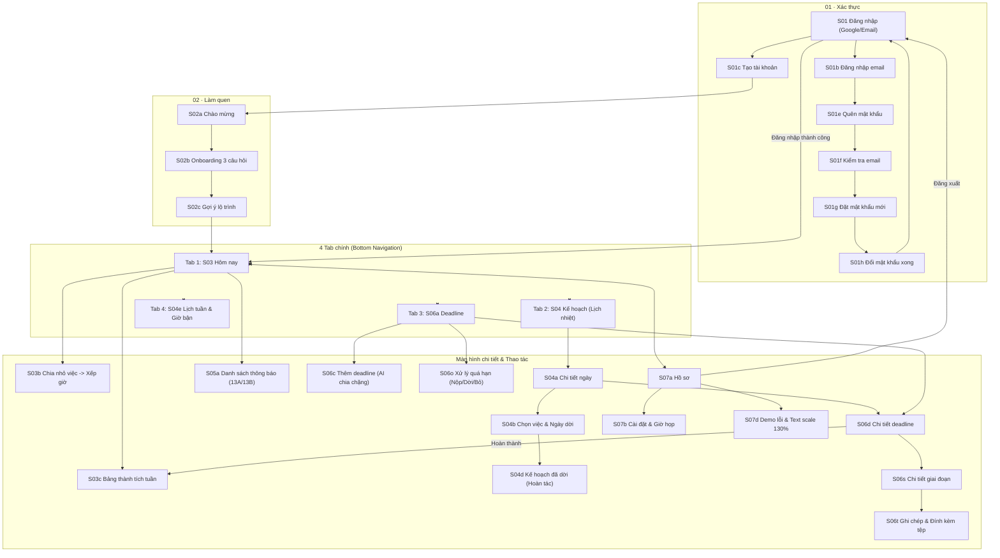
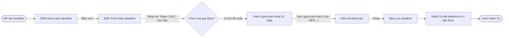
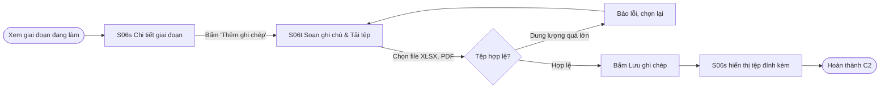
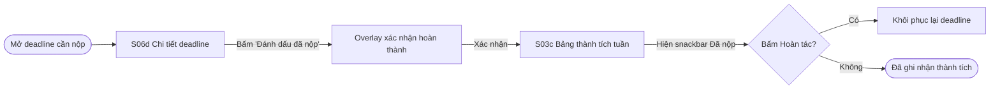
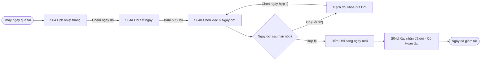

# Information architecture và user flow

Nguồn thiết kế: Trang **01 User Flow** và **06 Prototype** trong file Figma [`PRM393-LAB2-Study-Planner`](https://www.figma.com/design/OkTRYkrsoJ0nkluNO4mrHz/PRM393-LAB2-Study-Planner?node-id=767-1906). Tài liệu này khớp hoàn toàn với cấu trúc 7 phân hệ màn hình và các luồng tương tác trên Figma.

---

## 1. Information architecture

### 1.1 Danh sách phân hệ và màn hình (7 nhóm theo Final UI & Prototype)

| Nhóm | Mã màn | Tên màn hình / Frame Figma | Mục đích & Chức năng | Vào từ |
|---|---|---|---|---|
| **01 · Xác thực** | S01 | Device · 1 · Đăng nhập | Đăng nhập bằng Google hoặc chuyển sang đăng nhập Email | Mở app, Đăng xuất ở S07a |
| | S01b | Device · 1b · Đăng nhập bằng email | Form nhập Email và Mật khẩu | S01 (chọn Đăng nhập bằng email) |
| | S01c | Device · 1c · Tạo tài khoản (Đăng ký) | Form đăng ký: Tên hiển thị, Email, Mật khẩu (≥ 8 ký tự) | S01, S01b |
| | S01d | Device · 1d · Lỗi đăng nhập | Trạng thái báo lỗi "Sai email hoặc mật khẩu" | S01b khi nhập sai |
| | S01e | Device · 1e · Quên mật khẩu | Nhập email nhận link khôi phục mật khẩu | S01b (Quên mật khẩu?) |
| | S01f | Device · 1f · Kiểm tra email | Hướng dẫn mở app email hoặc gửi lại link | S01e sau khi gửi link |
| | S01g | Device · 1g · Đặt mật khẩu mới | Form nhập mật khẩu mới và xác nhận mật khẩu | Mở từ link email |
| | S01h | Device · 1h · Đổi mật khẩu thành công | Thông báo đổi thành công, nút quay lại Đăng nhập | S01g |
| **02 · Làm quen** | S02a | Device · 2a · Chào mừng | Giới thiệu app và mascot Tụi Nốt | Sau khi đăng ký S01c |
| | S02b | Device · 2b · Onboarding 3 câu hỏi | Khảo sát cá nhân hóa: nhịp làm việc, cách nhắc, mục tiêu | S02a |
| | S02c | Device · 2c · Gợi ý lộ trình & Bắt đầu | Gợi ý thiết lập ban đầu và vào màn chính | S02b |
| **03 · Hôm nay** | S03 | Device · 3 · Hôm nay (Tab 1) | Dashboard tổng quan: việc làm tiếp, lịch bận, deadline gấp | Sau đăng nhập, thanh điều hướng |
| | S03b | Device · 2c0, 2c3 · Chia nhỏ việc -> Xếp giờ | Hỗ trợ chia việc lớn thành các phiên 45p và xếp vào giờ trống | S03, Flow P7 |
| | S03c | Device · 3b · Bảng thành tích tuần này | Thống kê số việc đã nộp đúng hạn, chuỗi đúng hạn (streak) | S03, sau khi nộp bài C3 |
| **04 · Kế hoạch** | S04 | Device · 4 · Kế hoạch (Lịch nhiệt - Tab 2) | Lịch nhiệt tháng 5 mức (heat-0 đến heat-5) kèm mascot cảm xúc | Thanh điều hướng |
| | S04a | Device · 4a · Chi tiết ngày | Danh sách công việc và lịch bận của ngày đã chọn | Chạm một ngày ở S04 |
| | S04b | Device · 4b · Chọn việc và ngày để dời | Chọn việc nặng và ngày trống đề xuất để dời | S04a (nút Dời việc) |
| | S04c | Device · 4c · Chọn ngày khác | Chọn ngày tùy ý trong tháng (chặn ngày sau deadline) | S04b |
| | S04d | Device · 3d · Kế hoạch đã dời | Xác nhận dời thành công, có nút Hoàn tác | S04b, S04c |
| | S04e | Device · 4.2 · Lịch tuần & Giờ bận | Dải 7 ngày, quản lý khung giờ bận và giờ trống | S04, Tab Lịch bận |
| **05 · Thông báo** | S05a | Device · 13A · Thông báo (Nền nhạt chưa đọc) | Danh sách thông báo, nền nhạt cho tin chưa đọc, Đọc hết | Icon chuông ở Hôm nay |
| | S05b | Device · 13B · Thông báo (Kiểu hộp thư) | Danh sách dạng hộp thư với chấm xanh chưa đọc | Chuyển chế độ ở S05a |
| | S05c | Device · 13c · Thông báo đẩy màn hình khóa | Push notifications khi app chạy nền / tắt màn hình | Hệ thống OS gửi đến |
| **06 · Deadline** | S06a | Device · 6.1 · Danh sách deadline (Tab 3) | Toàn bộ deadline phân theo mức gấp: Quá hạn, Hôm nay, Tuần này... | Thanh điều hướng |
| | S06b | Device · 6.2 · Theo môn hoặc dự án | Nhóm deadline theo Môn học (PRM, WDP...), Đề tài NCKH, Dự án | S06a (Segmented control) |
| | S06c | Device · 6.3 · Thêm deadline | Form thêm deadline: 3 trường bắt buộc + AI chia giai đoạn | Nút FAB (+) ở S06a |
| | S06d | Device · 7d · Chi tiết deadline | Tên, nhóm việc, hạn chót, danh sách giai đoạn & buổi làm | S03, S06a, S04a |
| | S06s | Device · 7s, 7s1, 7s2 · Chi tiết giai đoạn | Tiến độ giai đoạn, người phụ trách, số ngày phủ kín | S06d (chạm một giai đoạn) |
| | S06t | Device · 7t · Thêm ghi chép & Đính kèm tệp | Ghi chú kết quả, tải file đính kèm DOCX, PDF, XLSX, ZIP | S06s |
| | S06e | Device · 5e · Đã xoá deadline (Overlay Xoá) | Xác nhận xóa deadline và hoàn tác | Menu ba chấm ở S06d |
| | S06o | Device · 5o1, 7o2, 5o2, 5o3 · Quá hạn & Xử lý | Lựa chọn khi trễ hạn: Nộp muộn, Dời hạn, hoặc Bỏ deadline | S06a (mục Quá hạn) |
| **07 · Hồ sơ · Cài đặt** | S07a | Device · 7.1 · Hồ sơ | Thông tin người dùng, email, tiến độ chung, nút Đăng xuất | Avatar ở góc màn hình |
| | S07b | Device · 7.2 · Cài đặt | Cài đặt nhắc hạn, chế độ im lặng/không làm phiền khi đang họp | S07a |
| | S07c | Device · 7.3 · Hướng dẫn sử dụng | Giải thích cách tính điểm nhiệt, ý nghĩa biểu tượng mascot | S07a |
| | S07d | Device · 7.4 · Công cụ demo & Kiểm tra lỗi | Demo accessibility (text scale 130%), mô phỏng lỗi mạng | S07a |

---

### 1.2 Sơ đồ điều hướng tổng thể (Navigation Architecture)

---

## 2. Danh mục User Flows (Theo trang 06 Prototype)

### 2.1 Flow chính (Core Flows)

#### Flow C1 · Thêm deadline dài hạn và chia giai đoạn khớp số ngày (Persona: Minh, Bảo Ngọc)
- **Bắt đầu:** Tab Deadline (S06a) hoặc nút Thêm (+) trên Hôm nay.
- **Mục tiêu:** Thêm một đề tài/deadline dài (ví dụ: *Paper hội nghị 15/11*), chia thành 4 giai đoạn khớp đúng 31 ngày từ hôm nay đến hạn chót, gán người phụ trách.
- **Kết thúc:** Deadline được lưu kèm đầy đủ các giai đoạn và buổi làm trên lịch.
- **Nhánh thay thế:** Tự điều chỉnh số ngày từng giai đoạn hoặc để AI tự động chia đều.
- **Nhánh lỗi & phục hồi (S1):** Tổng số ngày của các giai đoạn không khớp số ngày tới hạn chót -> hiển thị cảnh báo đỏ và nút "Khớp lại tự động".

#### Flow C2 · Cập nhật tiến độ giai đoạn, ghi chép và đính kèm tài liệu (Persona: Minh)
- **Bắt đầu:** Mở Chi tiết deadline từ Hôm nay hoặc Kế hoạch.
- **Mục tiêu:** Ghi chép kết quả thực nghiệm và đính kèm các file tài liệu (DOCX, PDF, XLSX, ZIP) trực tiếp vào giai đoạn đang làm.
- **Kết thúc:** Tệp đính kèm và ghi chú hiển thị đầy đủ trong chi tiết giai đoạn.
- **Nhánh thay thế:** Xóa bớt tệp hoặc thay thế tệp mới.

#### Flow C3 · Hoàn thành deadline / Đánh dấu đã nộp & Bảng thành tích (Persona: Minh, Đăng Khoa, Quốc Huy)
- **Bắt đầu:** Màn hình Chi tiết deadline (S06d).
- **Mục tiêu:** Đánh dấu hoàn thành deadline, xem xác nhận và ghi nhận vào Bảng thành tích tuần.
- **Kết thúc:** Deadline chuyển sang nhóm "Đã nộp", tăng điểm chuỗi streak trên S03c.
- **Nhánh phục hồi:** Bấm nút "Hoàn tác" trên snackbar để đưa việc trở lại trạng thái đang làm.

#### Flow C4 · Dời việc khi ngày quá nặng (Persona: Đăng Khoa)
- **Bắt đầu:** Tab Kế hoạch (S04) khi thấy ngày chuyển sang màu đỏ (Quá tải).
- **Mục tiêu:** Dời bớt buổi làm sang ngày nhẹ hơn trong tuần chỉ với vài lần chạm.
- **Kết thúc:** Lịch nhiệt cập nhật hạ nhiệt độ ngày, buổi làm chuyển sang ngày mới.
- **Nhánh thay thế / Lỗi (S2):** Chọn ngày dời nằm sau hạn chót deadline -> hệ thống gạch đỏ ngày đó, hiện cảnh báo và khóa nút Dời.

---

### 2.2 Flow phụ (Peripheral Flows)

- **P1 · Đăng ký & Onboarding 3 câu hỏi làm quen (Bảo Ngọc):**
  `S01c Tạo tài khoản` → `S02a Chào mừng` → `S02b Trả lời 3 câu hỏi` (Nhịp sinh hoạt, Thói quen học, Cách nhận nhắc nhở) → `S02c Gợi ý lộ trình` → `S03 Hôm nay`. Giúp người mới dùng app dưới 2 phút.
- **P2 · Đăng nhập hệ thống:**
  Đăng nhập bằng Google (1 chạm) hoặc qua form Email & Mật khẩu (`S01b`). Có xử lý hiển thị lỗi sai thông tin (`S01d`).
- **P3 · Quên mật khẩu & Khôi phục qua Email:**
  `S01b` → `S01e Quên mật khẩu` → Gửi link → `S01f Kiểm tra email` → `S01g Đặt mật khẩu mới` → `S01h Hoàn tất` → Đăng nhập lại.
- **P4 · Lọc và phân loại deadline:**
  Tại Tab Deadline (`S06a`), chuyển đổi Segmented Control giữa "Theo thời hạn" và "Theo môn học / Dự án" (`S06b`).
- **P5 · Sửa & Xóa deadline:**
  Tại Chi tiết deadline (`S06d`), bấm menu ba chấm → Sửa form hoặc Xóa (hiện overlay xác nhận destructive). Xóa xong có snackbar "Hoàn tác" đưa việc trở lại (`S06e`).
- **P6 · Xử lý deadline quá hạn (Trễ hạn):**
  Khi có deadline quá hạn (`S06o`), người dùng có 3 lựa chọn xử lý: (1) Nộp muộn, (2) Dời hạn chót sang ngày mới (`7o2`), hoặc (3) Bỏ deadline (`5o3`).
- **P7 · Chia nhỏ việc lớn & xếp vào giờ trống (Bảo Ngọc):**
  Tại Hôm nay (`S03`), chọn việc lớn chưa làm → mở công cụ `S03b Chia nhỏ việc` → hệ thống tự chia thành các phiên 45 phút và tự động gắn vào các khung giờ trống của tuần.
- **P8 · Quản lý giờ bận và dời buổi làm khi đổi ca (Đăng Khoa & Quốc Huy):**
  Tại Lịch tuần (`S04e`), bấm thêm khung giờ bận (ca làm quán cà phê hoặc giờ họp công ty) trong ≤ 3 chạm. Nếu trùng với buổi làm, app tự động gợi ý lùi buổi làm sang ngày khác trong < 10 giây.

---

### 2.3 Trạng thái lỗi và phục hồi (States & Error Recovery)

- **S1 · Lỗi nhập liệu và mất kết nối mạng:**
  - Báo lỗi trực tiếp dưới từng text field nếu bỏ trống trường bắt buộc hoặc mật khẩu < 8 ký tự.
  - Khi mất mạng: app chuyển sang chế độ Offline, dữ liệu nhập được giữ nguyên trong bộ nhớ tạm, hiển thị banner màu đỏ nhạt kèm nút "Thử lại".
- **S2 · Xung đột lịch & Cảnh báo hạn nộp:**
  - Không cho phép dời buổi làm hoặc dời deadline về thời điểm trong quá khứ hoặc sau ngày kết thúc môn học.
  - Cảnh báo xung đột nếu khung giờ bận trùng hoàn toàn với giờ học trên trường.

---

## 3. Bảng ánh xạ Flow - Màn hình - Persona

| Mã Flow | Tên Flow | Persona kiểm thử | Màn hình tham gia | Overlay / Trạng thái |
|---|---|---|---|---|
| **C1** | Thêm deadline & chia giai đoạn | Minh, Bảo Ngọc | S06a, S06c, S06d, S06s | AI chia chặng, cảnh báo khớp ngày |
| **C2** | Ghi chép & Đính kèm tệp | Minh | S06d, S06s, S06t | Tải tệp DOCX/PDF/XLSX/ZIP |
| **C3** | Hoàn thành & Thành tích | Minh, Đăng Khoa, Huy | S06d, S03c, S03 | Overlay xác nhận, snackbar Hoàn tác |
| **C4** | Giảm tải ngày quá nặng | Đăng Khoa | S04, S04a, S04b, S04c, S04d | Khóa nút dời sau hạn nộp |
| **P1** | Đăng ký & Onboarding | Bảo Ngọc | S01c, S02a, S02b, S02c, S03 | Khảo sát 3 câu hỏi |
| **P2** | Đăng nhập Google / Email | Tất cả | S01, S01b, S01d, S03 | Trạng thái lỗi S01d |
| **P3** | Quên & Đặt lại mật khẩu | Minh, Huy | S01e, S01f, S01g, S01h | Link email xác thực |
| **P4** | Lọc theo môn & dự án | Minh, Huy | S06a, S06b | Segmented control |
| **P5** | Sửa & Xóa deadline | Tất cả | S06d, S06e | Overlay destructive, Hoàn tác |
| **P6** | Xử lý deadline trễ hạn | Tất cả | S06a, S06o, 7o2, 5o2, 5o3 | Nộp muộn / Dời hạn / Bỏ |
| **P7** | Chia nhỏ việc & Xếp giờ | Bảo Ngọc | S03, S03b | Xếp phiên 45 phút vào giờ trống |
| **P8** | Quản lý giờ bận & Đổi ca | Đăng Khoa, Huy | S04e, S04a, S04b | Thêm giờ bận, tự lùi buổi làm |
| **S1** | Lỗi nhập & Lỗi mất mạng | Tất cả | Toàn bộ màn hình | Offline state, Retry button |
| **S2** | Xung đột lịch & Sau hạn | Tất cả | S04b, S04c, S06c | Warning banner, nút bị vô hiệu hóa |

---

## 4. Đối chiếu yêu cầu đề bài môn học

| Tiêu chuẩn yêu cầu | Hiện trạng đáp ứng trong Nốt |
|---|---|
| Số lượng màn hình (≥ 8 màn) | **25+ device frames** trải dài trên 7 phân hệ hoàn chỉnh |
| Số lượng user flows (≥ 3 flows) | **14 flows & trạng thái** (4 flow chính C1–C4, 8 flow phụ P1–P8, 2 trạng thái S1–S2) |
| Nhánh thay thế và rẽ nhánh | Tất cả các flow đều có rẽ nhánh theo tình huống người dùng |
| Nhánh lỗi và cơ chế phục hồi | Đầy đủ: Lỗi nhập liệu, Lỗi mạng offline, Cảnh báo ngày sau hạn nộp, và cơ chế Hoàn tác (Undo) |
| Dialog dạng overlay | Overlay xác nhận hoàn thành, Overlay xác nhận xóa, Overlay bỏ deadline |
| Trạng thái chuyển đổi (Loading sang Populated) | Trạng thái skeleton loading, nút đang tải và chuyển sang kết quả |

