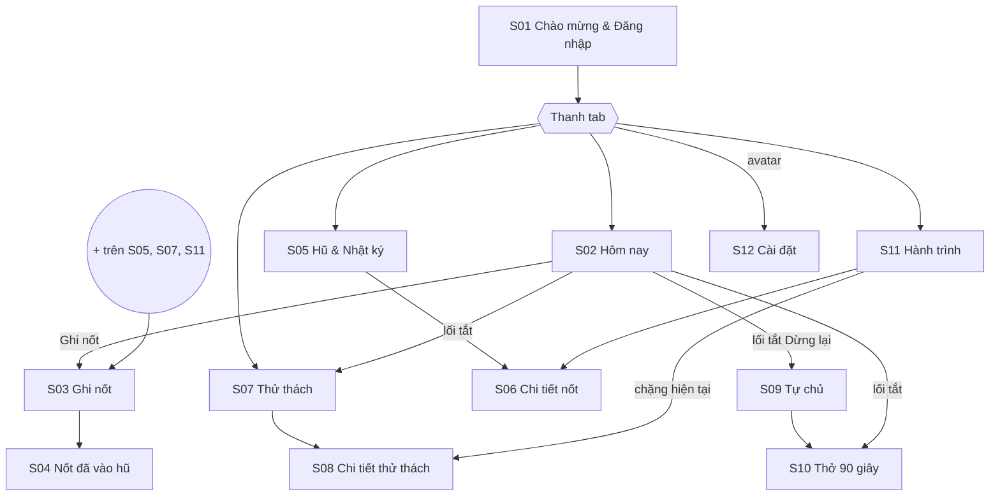
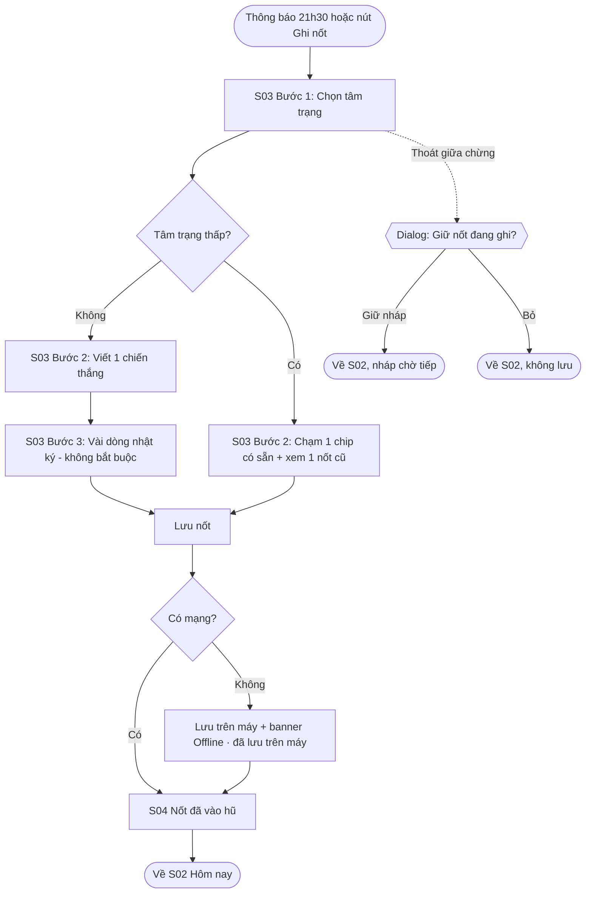
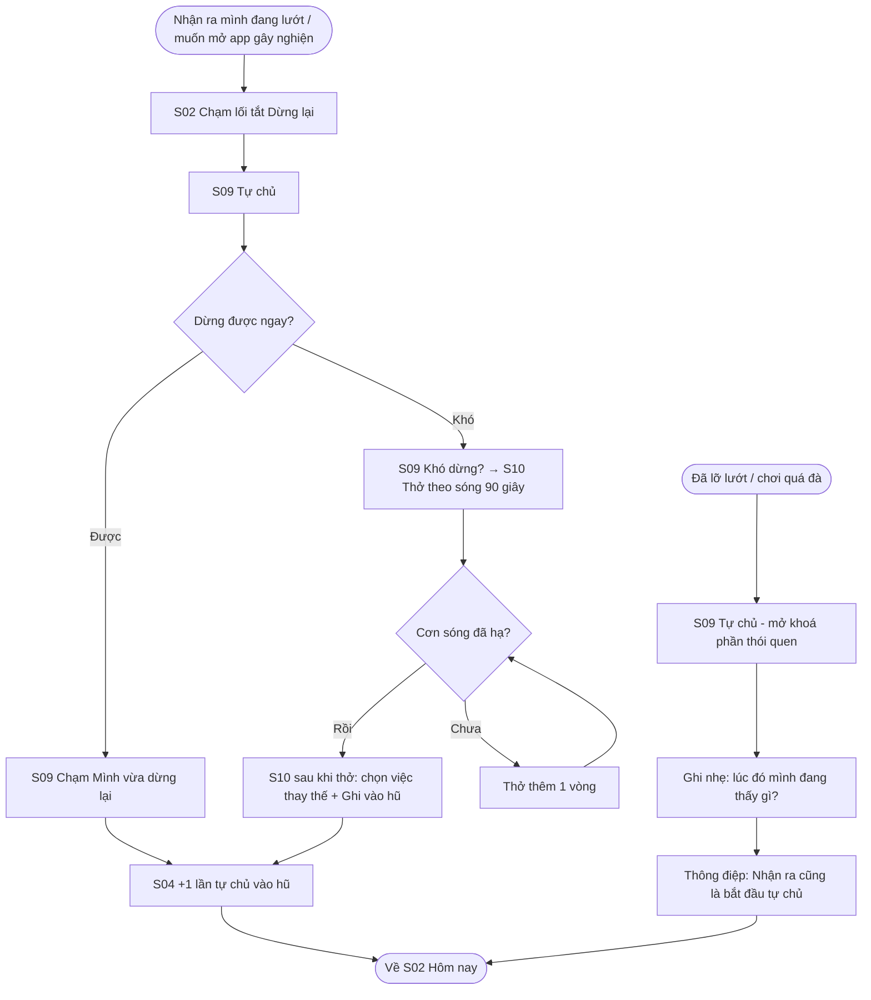
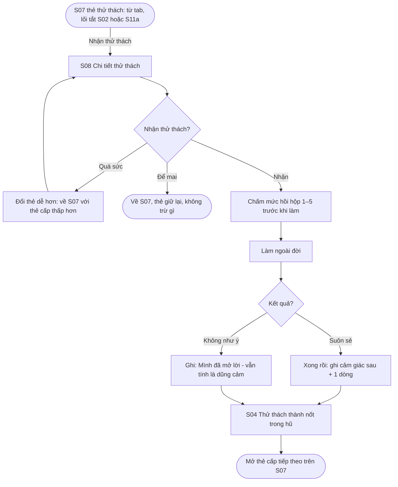
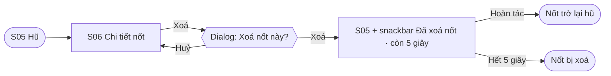
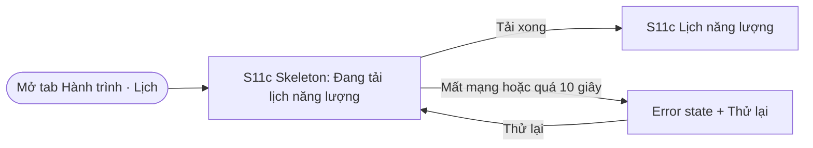

# Information architecture và user flow

Bản cho app Nốt sau khi đổi hướng ngày 24/10/2026 (app ghi chú tích cực, 5 ý). Mã màn `S01`–`S12` giống tên frame ở page `03 Final UI`, section **Final UI · Nốt tích cực (24/10)**. Mã flow giống page `01 User Flow` (khung "User Flow · Nốt tích cực (24/10)") và page `06 Prototype`.

Bộ flow: **3 flow chính** (F1–F3), **8 flow phụ** (P1–P8), **3 flow trạng thái** (T1–T3). Cả 12 màn hình đều thuộc ít nhất một flow.

---

## 1. Information architecture

### 1.1 Cấu trúc điều hướng

- **Cổng vào:** `S01` khi chưa đăng nhập.
- **4 tab cấp cao nhất** (component `BottomNav · Nốt`): Hôm nay (`S02`), Hũ (`S05`), Thử thách (`S07`), Hành trình (`S11`).
- **Nút "Ghi nốt"** trên `S02` và **nút nổi +** ở góc dưới phải của `S05`, `S07`, `S11` mở `S03` toàn màn hình. Thông báo buổi tối cũng mở thẳng `S03`.
- **Lối tắt trên `S02`:** 3 nút tròn "Dừng lại" (→ `S09`), "Thở 90 giây" (→ `S10`), "Thử thách" (→ `S07`).
- **Avatar** ở góc trên phải của 4 màn tab mở `S12` Cài đặt. Nút chuông cạnh avatar chưa có màn đích trong Figma (xem mục 1.3).
- **Màn lồng** (có nút Back, không có thanh tab): `S03`, `S04`, `S06`, `S08`, `S09`, `S10`, `S12`.
- Dialog và biến thể trạng thái không tính là màn hình riêng.

"Hũ" = hũ chiến thắng: mỗi chiến thắng (kể cả một lần tự chủ hay một lần vận động) là một tờ nốt rơi vào hũ. Ngày tâm trạng thấp, app lấy ra một nốt cũ cho xem.

### 1.2 Danh sách màn hình (12 màn)

| Mã | Màn hình | Cấp | Vào từ | Frame ở page 03 (gồm biến thể trạng thái) |
|---|---|---|---|---|
| S01 | Chào mừng & Đăng nhập | Cổng vào | Mở app khi chưa đăng nhập | `S01 · Chào mừng & Đăng nhập` |
| S02 | Hôm nay | Tab 1 | Sau đăng nhập, thanh tab | `S02 · Hôm nay` |
| S03 | Ghi nốt (3 bước: tâm trạng → chiến thắng → vài dòng) | Lồng, toàn màn hình | Nút "Ghi nốt" (S02), nút + (S05, S07, S11), thông báo buổi tối | `S03a · bước 1 tâm trạng`, `S03a · chọn Rối (sơ cứu tinh thần)`, `S03b · bước 2 chiến thắng`, `S03b · dialog thoát giữa chừng`, `S03c · bước 3 nhật ký`, 5 frame `S03b · AI · …` |
| S04 | Nốt đã vào hũ (kết quả) | Lồng | S03 sau khi lưu | `S04 · Nốt đã vào hũ`, `S04 · lưu khi mất mạng`, `S04 · đạt mốc tháng` |
| S05 | Hũ & Nhật ký | Tab 2 | Thanh tab | `S05 · Hũ & Nhật ký`, `S05 · hũ rỗng`, `S05 · mất mạng, chưa có dữ liệu`, `S05 · vừa xoá nốt (hoàn tác)` |
| S06 | Chi tiết nốt (xem / sửa / viết nhật ký) | Lồng | S05, S11 | `S06 · Chi tiết nốt`, `S06 · dialog xoá nốt` |
| S07 | Thử thách | Tab 3 | Thanh tab, lối tắt trên S02, chặng trên S11a, "Đổi thẻ dễ hơn" ở S08 | `S07 · Thử thách` |
| S08 | Chi tiết thử thách (làm + ghi cảm giác trước/sau, ghi vận động) | Lồng | S07, S11a | `S08 · Chi tiết thử thách` |
| S09 | Tự chủ (phần thói quen khoá bằng PIN / sinh trắc học) | Lồng | Lối tắt "Dừng lại" trên S02 | `S09 · Tự chủ` |
| S10 | Thở 90 giây khi khó dừng | Lồng | S09, lối tắt trên S02 | `S10 · Thở 90 giây`, `S10 · sau khi thở` |
| S11 | Hành trình (3 tab con: Con đường, Thống kê, Lịch năng lượng) | Tab 4 | Thanh tab | `S11a · Con đường`, `S11b · Thống kê` (+ cuộn xuống, Thẻ tuần), `S11c · Lịch` (+ đang tải, xem theo năm), `S11 · Hỏi Nốt (AI, bonus)` |
| S12 | Cài đặt (giờ nhắc, Giờ tỉnh, khoá, Nốt AI, đăng xuất) | Lồng | Avatar trên 4 màn tab | `S12 · Cài đặt`, `S12 · Cài đặt · bật/tắt Nốt AI` |

### 1.3 Dialog và trạng thái đi kèm

| Loại | Nội dung | Ở màn |
|---|---|---|
| Dialog xác nhận (overlay) | "Giữ nốt đang ghi?" — Bỏ / Giữ nháp | S03 (frame `Overlay · Giữ nốt đang ghi?`) |
| Dialog destructive | "Xoá nốt này?" — Huỷ / Xoá, sau đó snackbar "Đã xoá nốt · còn 5 giây" + Hoàn tác | S06 → S05 |
| Dialog đăng xuất | "Đăng xuất khỏi Nốt?" | S12 |
| Xin quyền thông báo | Dialog hệ thống Android 13+ | P1, P8 |
| Banner | "Offline · đã lưu trên máy" | S04 |
| Empty state | Hũ còn trống + "Ghi nốt đầu tiên" | S05 |
| Loading | Skeleton "Đang tải lịch năng lượng…" | S11c |
| Error state | "Chưa tải được hũ" + Thử lại | S05 |
| Nút chuông (chưa nối) | Figma vẽ chuông ở 4 màn tab nhưng chưa có màn đích; handoff đề xuất mở `S12` mục Nhắc nhở | S02, S05, S07, S11 |
| Gợi ý hỗ trợ | Tâm trạng "Rối" → "Sơ cứu 1 phút: 5-4-3-2-1"; trầm nhiều ngày → gợi ý người để nói chuyện / đường dây hỗ trợ | S03a, P6 |

---

## 2. User flow

### F1 · Ghi nốt buổi tối (flow chính, có nhánh lỗi)

- **Bắt đầu:** 21h30, thông báo "Hôm nay bạn đã làm được gì?" (hoặc nút "Ghi nốt" trên `S02`).
- **Mục tiêu:** lưu một chiến thắng nhỏ, có thể kèm vài dòng nhật ký.
- **Kết thúc:** `S04` — nốt rơi vào hũ, Tụi Nốt phản hồi, quay về `S02`.
- **Happy path theo frame:** `S03a` → `S03b` ("Tiếp") → `S03c` ("Lưu vào hũ") → `S04`. "Bỏ qua nhật ký" ở `S03b` và "Bỏ qua" ở `S03c` đi thẳng tới `S04`.
- **Nhánh thay thế:** tâm trạng thấp → chạm một chip chiến thắng có sẵn, xem lại một nốt cũ; bỏ qua nhật ký. Chọn "Rối" → gợi ý "Sơ cứu 1 phút". Kể tự do → Nốt AI tách thành các nốt để người dùng xác nhận (thiết kế sẵn cho Final Assignment, xem `S03` trong [`design/screen-spec.md`](../design/screen-spec.md)).
- **Nhánh lỗi / phục hồi:** mất mạng → lưu nháp trên máy, banner, tự đồng bộ khi có mạng; thoát giữa chừng → dialog "Giữ nốt đang ghi?".

### F2 · Tự chủ: dừng lướt vô thức (flow chính, có nhánh phục hồi)

Ý số 3 "Tự chủ": tự chủ trước dopamine rẻ — lướt mạng xã hội vô thức, video ngắn, game quá giờ, nội dung không lành mạnh. Nhận ra rồi dừng lại cũng là một lần tự chủ.

- **Bắt đầu:** 0h, Minh nhận ra mình đã lướt TikTok 40 phút (hoặc đang muốn mở game, nội dung không lành mạnh).
- **Mục tiêu:** chủ động đặt điện thoại xuống, và được ghi nhận vì điều đó.
- **Kết thúc:** +1 lần tự chủ rơi vào hũ, chuyển sang việc khác.
- **Nhánh thay thế:** khó dừng → `S10` thở theo sóng 90 giây, rồi chọn việc thay thế (đi bộ, uống nước, nhắn bạn, đi ngủ).
- **Nhánh phục hồi:** đã lỡ lướt / chơi quá đà → ghi nhẹ "lúc đó mình đang thấy gì?", không trừ gì; thông điệp "Nhận ra cũng là bắt đầu tự chủ".

Nút "Dừng lại" trên `S02` mở `S09`; nút "Mình vừa dừng lại" ở `S09` ghi ngay một lần tự chủ và mở `S04` (tổng 2 chạm, không cần mở khoá). Chỉ mục "Thói quen muốn bớt" ở `S09` bị che đến khi mở khoá (riêng tư). "Giờ tỉnh" (vd. 23h–1h) để app nhắc nhẹ.

### F3 · Nhận và hoàn thành một thử thách (flow chính)

- **Bắt đầu:** buổi sáng, `S07` (mở từ tab, lối tắt "Thử thách" trên `S02`, hoặc chặng hiện tại trên `S11a`) gợi ý một thẻ thử thách hợp tâm trạng hôm qua (vd. "Hỏi thầy 1 câu sau giờ học", "Đi bộ 10 phút").
- **Mục tiêu:** làm thử thách ngoài đời và ghi cảm giác trước/sau.
- **Kết thúc:** thử thách thành một nốt trong hũ, thẻ cấp tiếp theo được mở.
- **Nhánh thay thế:** quá sức → "Đổi thẻ dễ hơn"; chưa có dịp → để mai, không bị trừ gì.
- **Nhánh "không như ý":** người kia không trả lời / bị từ chối → vẫn tính là dũng cảm, ghi "mình đã mở lời".

### Flow phụ và trạng thái

Sơ đồ đầy đủ ở Figma page `01 User Flow` (nhóm "Flow phụ · P1–P8" và "Trạng thái & lỗi · T1–T3").

| Mã | Flow | Bắt đầu → kết thúc | Nhánh lỗi / phục hồi | Màn hình |
|---|---|---|---|---|
| P1 | Làm quen lần đầu | Mở app lần đầu → S02 | Đăng nhập thất bại → báo lỗi + Thử lại | S01, S12, S02 |
| P2 | Đăng ký email & quên mật khẩu | S01 chưa có tài khoản → S02 | Dữ liệu sai báo ngay dưới ô; quên mật khẩu → link qua email (báo chung, không lộ email nào có tài khoản) | S01, S12, S02 |
| P3 | Ghi một lần vận động (ý 5) | Vừa đi bộ / tập xong → nốt vận động vào hũ | Dừng sớm vẫn ghi "mình đã ra ngoài 4 phút" | S02, S07, S08, S04 |
| P4 | Viết nhật ký dài (ý 2) | Đầu óc rối → nhật ký vào dòng thời gian | Bí ý → câu gợi ý; app bị tắt → "Tiếp tục bản nháp?" | S05, S06 |
| P5 | Xem, sửa, xoá một nốt | Mở tab Hũ → nốt đã sửa / đã xoá | Dialog xoá (destructive), Hoàn tác 5 giây | S05, S06 |
| P6 | Ngày tệ: nhìn lại hành trình | Mở Hành trình → đọc lại chiến thắng cũ | Trầm nhiều ngày → dialog gợi ý người để nói chuyện / đường dây hỗ trợ | S11, S05, S06 |
| P7 | Thông báo → mở đúng màn hình | Chạm thông báo (nhắc tối / Giờ tỉnh / thẻ mới) → tiếp F1 / F2 / F3 | Đang đăng xuất → S01 trước rồi mới tới đích | S03, S02, S08 |
| P8 | Hồ sơ & cài đặt | Chạm avatar ở một màn tab → đã lưu giờ nhắc / Giờ tỉnh / khoá / Nốt AI / đăng xuất | Từ chối quyền thông báo (Android 13+) → banner bật lại trong Cài đặt máy | S02, S12, S01 |
| T1 | Hũ rỗng | Người mới mở Hũ → nốt đầu tiên | Empty state: minh họa + lời mời + 1 nút | S05, S03, S04 |
| T2 | Mất mạng / tải lỗi | Mở S05/S11 offline → dữ liệu cũ + banner hoặc màn lỗi | Error state: lý do dễ hiểu + Thử lại | S05, S11 |
| T3 | Đang tải → kết quả | Mở Hành trình → skeleton → lịch đầy đủ | Quá 10 giây → chuyển sang T2 | S11 |

Hai flow phụ có nhánh phục hồi quan trọng, vẽ thêm:

---

## 3. Bảng ánh xạ flow sang màn hình

| Màn hình | Flow chính | Flow phụ / trạng thái |
|---|---|---|
| S01 Chào mừng & Đăng nhập | | P1, P2, P8 |
| S02 Hôm nay | F1, F2, F3 | P1, P2, P3, P7, P8 |
| S03 Ghi nốt | F1 | P7, T1 |
| S04 Nốt đã vào hũ | F1, F3 | P3, T1 |
| S05 Hũ & Nhật ký | | P4, P5, P6, T1, T2 |
| S06 Chi tiết nốt | | P4, P5, P6 |
| S07 Thử thách | F3 | P3 |
| S08 Chi tiết thử thách | F3 | P3, P7 |
| S09 Tự chủ | F2 | P8 (khoá) |
| S10 Thở 90 giây | F2 | |
| S11 Hành trình | F3 (chặng hiện tại) | P6, T2, T3 |
| S12 Cài đặt | | P1, P2, P8 |

Theo chiều ngược lại (flow → màn):

| Flow | Màn hình theo thứ tự |
|---|---|
| F1 | S02 → S03a → S03b → S03c → S04 → S02 |
| F2 | S02 → S09 → S04 → S02; khó dừng: S09 → S10 → S04 |
| F3 | S07 → S08 → S04 → S07 |
| F4 (prototype) | S11a Con đường → S11b Thống kê → (chạm Mục tiêu tuần) Thẻ tuần |

---

## 4. Đối chiếu yêu cầu đề bài

| Yêu cầu (mục 3 và 6) | Đáp ứng |
|---|---|
| ≥ 8 màn hình khác nhau | 12 màn (S01–S12), không tính dialog và biến thể |
| ≥ 3 flow có bắt đầu, mục tiêu, kết thúc | F1, F2, F3 (cùng 8 flow phụ, 3 flow trạng thái) |
| ≥ 1 flow có nhánh lỗi hoặc phục hồi | F1 (mất mạng, thoát giữa chừng), F2 (đã lỡ lướt), P5 (hoàn tác xoá), T2 (Thử lại) |
| Mỗi flow có nhánh thay thế | Có, ghi ở từng flow |
| Danh sách màn và cấu trúc điều hướng | Mục 1.1, 1.2 |
| Mọi màn thuộc ít nhất một flow | Bảng mục 3 |
