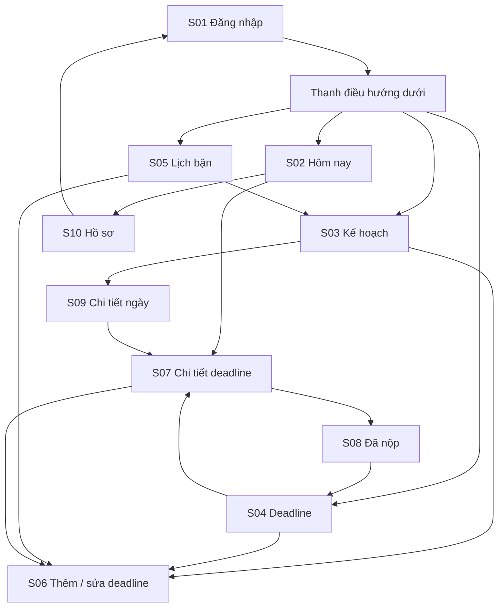
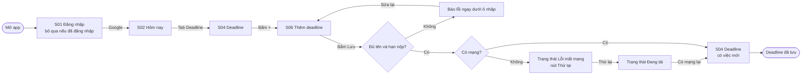
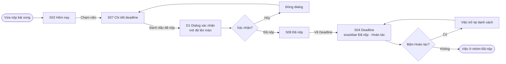
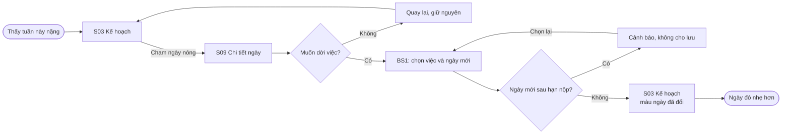
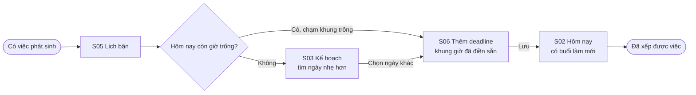
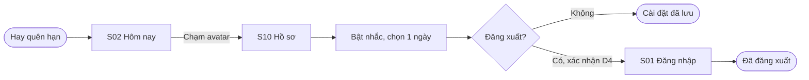

# Information architecture và user flow

Nguồn: page **01 User Flow** trong file Figma. File này và Figma phải luôn khớp nhau về tên màn hình, số flow và nhánh.

---

## 1. Information architecture

### 1.1 Danh sách màn hình

10 màn hình. Dialog, bottom sheet, snackbar và các biến thể trạng thái không tính là màn hình riêng.

| Mã | Màn hình | Cấp | Mục đích | Vào từ |
|---|---|---|---|---|
| S01 | Đăng nhập | Cổng vào | Đăng nhập bằng Google. Bỏ qua nếu đã đăng nhập | Mở app, Đăng xuất ở S10 |
| S02 | Hôm nay | Tab 1, màn mở đầu | Việc làm tiếp, lịch bận hôm nay, deadline gần nhất | S01, thanh điều hướng |
| S03 | Kế hoạch | Tab 2 | Lịch nhiệt khối lượng việc theo ngày | Thanh điều hướng, S05 |
| S04 | Deadline | Tab 3 | Mọi deadline, nhóm theo mức gấp | Thanh điều hướng, S08 |
| S05 | Lịch bận | Tab 4 | Lịch học cố định, họp nhóm, freelance và khung giờ trống theo ngày | Thanh điều hướng |
| S06 | Thêm / sửa deadline | Lồng | Form 3 trường bắt buộc: tên, nhóm việc, hạn nộp | S04 (nút +), S05 (khung trống), S03 (ngày đã chọn), S07 (Sửa) |
| S07 | Chi tiết deadline | Lồng | Thông tin, tiến độ, các buổi làm, đánh dấu đã nộp | S02, S04, S09 |
| S08 | Đã nộp | Lồng, toàn màn | Xác nhận đã nộp và khích lệ | S07 sau khi xác nhận |
| S09 | Chi tiết ngày | Lồng | Việc của một ngày, xem theo danh sách hoặc theo giờ, dời việc | S03 |
| S10 | Hồ sơ | Lồng | Tài khoản Google, nhắc trước hạn, đăng xuất | Avatar trên App bar của S02 |

### 1.2 Cấu trúc điều hướng

- **Top-level:** thanh điều hướng dưới có 4 điểm đến: Hôm nay, Kế hoạch, Deadline, Lịch bận. Sau khi đăng nhập, app mở vào S02.
- **Lồng:** mở chồng lên tab hiện tại, có App bar với nút Back, ẩn thanh điều hướng.
- **Độ sâu tối đa:** 2 bước từ một tab (ví dụ S04 → S07 → S08).
- **Back:**
  - Màn lồng: về màn trước đó.
  - S06 khi đã nhập dữ liệu: mở dialog D3 "Bỏ thay đổi?".
  - S08: về S04 (không quay lại S07).
  - Tab khác S02: về S02. Ở S02: thoát app.
  - S01: thoát app.

### 1.3 Dialog, bottom sheet và snackbar

| Mã | Thành phần | Xuất hiện ở | Nội dung |
|---|---|---|---|
| D1 | Dialog xác nhận | S07 | "Đánh dấu đã nộp Lab 2: Thiết kế UI?" Nút: Hủy, Đã nộp |
| D2 | Dialog destructive | S07 | "Xóa deadline này và 3 buổi làm của nó?" Nút: Hủy, Xóa |
| D3 | Dialog xác nhận | S06 | "Bỏ thay đổi chưa lưu?" Nút: Tiếp tục sửa, Bỏ |
| D4 | Dialog xác nhận | S10 | "Đăng xuất khỏi Nốt?" Nút: Hủy, Đăng xuất |
| BS1 | Bottom sheet Dời việc | S09 | Chọn ngày mới cho một việc. Báo lỗi nếu ngày mới sau hạn nộp |
| BS2 | Bottom sheet Thêm lịch bận | S05 | Tên, loại (Lịch học, Họp nhóm, Freelance), ngày, giờ bắt đầu, giờ kết thúc |
| SB | Snackbar | S04, S09 | "Đã nộp · Hoàn tác", "Đã dời sang thứ Năm · Hoàn tác", "Đã xóa · Hoàn tác" |

### 1.4 Biến thể trạng thái

| Trạng thái | Màn hình có trạng thái này |
|---|---|
| Đang tải (skeleton) | S02, S03, S04, S05, S07, S09 |
| Rỗng | S02, S04, S05, S09 |
| Lỗi mất mạng mức màn hình | S02, S03, S04, S05 |
| Lỗi khi lưu (giữ dữ liệu, nút Thử lại) | S06, BS1, BS2 |
| Lỗi nhập | S06, BS1, BS2 |
| Nút đang tải | S01, S06, S07 (Đã nộp) |

---

## 2. User flow

Chú giải giống page 01 trong Figma: hình tròn dài là điểm bắt đầu và kết thúc, hình chữ nhật là màn hình hoặc thao tác, hình thoi là điểm rẽ nhánh. Nhánh lỗi và phục hồi tô đỏ trong Figma.

### Flow 1 · Thêm deadline mới

- **Bắt đầu:** mở app.
- **Mục tiêu:** lưu một deadline mới chép từ nhóm Zalo, trong dưới 20 giây.
- **Kết thúc:** việc mới hiện trong danh sách Deadline.
- **Nhánh thay thế:** đã đăng nhập thì bỏ qua S01. Back khi đang nhập mở D3.
- **Nhánh lỗi và phục hồi:** thiếu tên hoặc hạn nộp, báo lỗi dưới ô nhập. Mất mạng khi lưu, giữ dữ liệu và cho Thử lại.

### Flow 2 · Nộp một deadline

- **Bắt đầu:** tab Hôm nay, ngay sau khi Hân vừa nộp bài.
- **Mục tiêu:** đánh dấu việc đã nộp.
- **Kết thúc:** việc nằm trong nhóm Đã nộp ở Deadline.
- **Nhánh thay thế:** hủy ở dialog xác nhận.
- **Nhánh phục hồi:** Hoàn tác trên snackbar đưa việc trở lại danh sách.

### Flow 3 · Giảm tải một ngày quá nặng

- **Bắt đầu:** tab Kế hoạch, khi Hân thấy tuần này nặng.
- **Mục tiêu:** dời bớt việc khỏi ngày nặng nhất.
- **Kết thúc:** lịch nhiệt đổi màu, ngày đó nhẹ hơn.
- **Nhánh thay thế:** không dời, quay lại giữ nguyên.
- **Nhánh lỗi:** ngày mới nằm sau hạn nộp, cảnh báo và không cho lưu.

### Flow 4 · Xếp một việc phát sinh

Flow chính, gắn với tiêu chí thành công: xếp việc phát sinh trong dưới 30 giây.

- **Bắt đầu:** có việc phát sinh, Hân mở tab Lịch bận.
- **Mục tiêu:** tìm giờ trống cho việc mới.
- **Kết thúc:** buổi làm mới hiện ở Hôm nay.
- **Nhánh thay thế:** hôm nay hết giờ trống, sang Kế hoạch tìm ngày nhẹ hơn.

### Flow 5 · Đổi nhắc hạn và đăng xuất

- **Bắt đầu:** tab Hôm nay, vì Hân hay quên hạn.
- **Mục tiêu:** bật nhắc trước hạn 1 ngày.
- **Kết thúc:** cài đặt đã lưu.
- **Nhánh thay thế:** đăng xuất, về màn Đăng nhập.

---

## 3. Bảng ánh xạ flow sang màn hình

| Flow | Màn hình sử dụng | Overlay và trạng thái |
|---|---|---|
| 1 · Thêm deadline mới | S01 Đăng nhập, S02 Hôm nay, S04 Deadline, S06 Thêm deadline | D3, lỗi nhập, Lỗi mất mạng, Đang tải |
| 2 · Nộp một deadline | S02 Hôm nay, S07 Chi tiết deadline, S08 Đã nộp, S04 Deadline | D1, snackbar Hoàn tác |
| 3 · Giảm tải một ngày quá nặng | S03 Kế hoạch, S09 Chi tiết ngày | BS1, lỗi ngày sau hạn nộp |
| 4 · Xếp một việc phát sinh | S05 Lịch bận, S06 Thêm deadline, S02 Hôm nay, S03 Kế hoạch | Không |
| 5 · Đổi nhắc hạn và đăng xuất | S02 Hôm nay, S10 Hồ sơ, S01 Đăng nhập | D4 |

| Màn hình | F1 | F2 | F3 | F4 | F5 |
|---|:-:|:-:|:-:|:-:|:-:|
| S01 Đăng nhập | ✓ | | | | ✓ |
| S02 Hôm nay | ✓ | ✓ | | ✓ | ✓ |
| S03 Kế hoạch | | | ✓ | ✓ | |
| S04 Deadline | ✓ | ✓ | | | |
| S05 Lịch bận | | | | ✓ | |
| S06 Thêm / sửa deadline | ✓ | | | ✓ | |
| S07 Chi tiết deadline | | ✓ | | | |
| S08 Đã nộp | | ✓ | | | |
| S09 Chi tiết ngày | | | ✓ | | |
| S10 Hồ sơ | | | | | ✓ |

Cả 10 màn hình đều thuộc ít nhất một flow.

---

## 4. Đối chiếu với yêu cầu đề

| Yêu cầu | Đáp ứng ở đâu |
|---|---|
| Ít nhất 8 màn hình | 10 màn hình, S01 đến S10 |
| Ít nhất 3 flow có bắt đầu, mục tiêu, kết thúc | 5 flow, mục 2 |
| Mỗi flow có nhánh thay thế | Mỗi flow có dòng "Nhánh thay thế" |
| Ít nhất 1 flow có nhánh lỗi hoặc phục hồi | Flow 1 (lỗi nhập, mất mạng), Flow 2 (hoàn tác), Flow 3 (ngày sau hạn nộp) |
| Bảng ánh xạ flow sang màn hình | Mục 3 |
| Prototype: một dialog dạng overlay | D1 ở Flow 2 |
| Prototype: chuyển cảnh loading sang kết quả | Flow 1: Đang tải sang S04 có việc mới |
